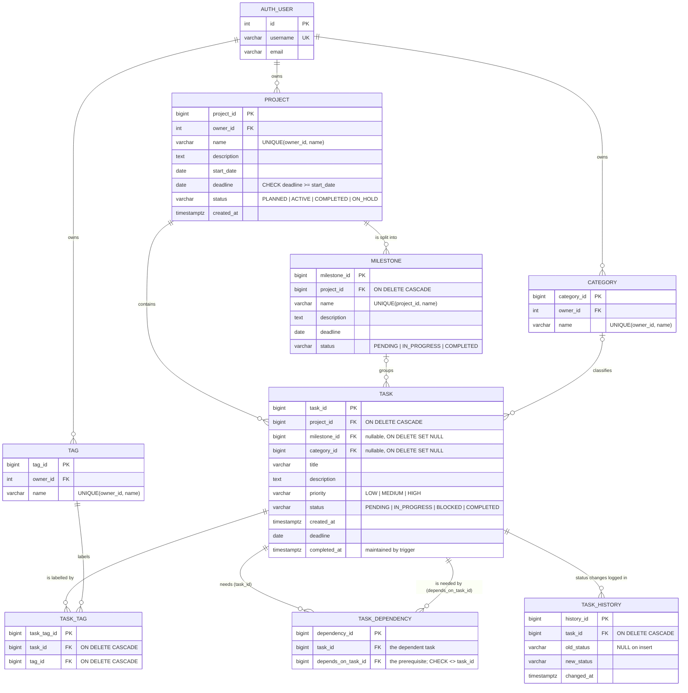

# TaskFlow: ER diagram and relational schema

## ER diagram

`auth_user` is Django's built-in user table; every other table is defined in
`tracker/models.py` with an explicit `db_table`. GitHub and most Markdown
viewers render the diagram below.

## The four relationships to explain

| Relationship | Cardinality | How it is implemented |
|---|---|---|
| project → task | 1 : N | `task.project_id` FK, `ON DELETE CASCADE`. A task belongs to exactly one project. |
| task → task_history | 1 : N | `task_history.task_id` FK, `ON DELETE CASCADE`. Rows are inserted **only** by trigger `trg_task_status_history`. |
| task ↔ tag | M : N | Resolved by the junction table `task_tag(task_id, tag_id)` with `UNIQUE(task_id, tag_id)`. Django uses it as an explicit `through` model. |
| task ↔ task (prerequisites) | recursive M : N | Junction `task_dependency(task_id, depends_on_task_id)`: both FKs point at `task`. `UNIQUE(task_id, depends_on_task_id)` stops duplicates and `CHECK (task_id <> depends_on_task_id)` stops self-loops. Longer cycles (A → B → A) span several rows, which a CHECK cannot see, so they are rejected by a depth-first search in `TaskDependencyForm.clean()`. |

The other relationships: project 1:N milestone (cascade), milestone 0..1:N task
(`SET NULL`, so deleting a milestone keeps its tasks), category 0..1:N task
(`SET NULL`), and user 1:N project/category/tag.

## Relational schema

Underline = primary key, *italic* = foreign key.

- **auth_user** (<u>id</u>, username, email, password, …)
- **category** (<u>category_id</u>, *owner_id* → auth_user, name)
  - UNIQUE (owner_id, name)
- **project** (<u>project_id</u>, *owner_id* → auth_user, name, description, start_date, deadline, status, created_at)
  - UNIQUE (owner_id, name)
  - CHECK (deadline >= start_date)
  - CHECK (status IN ('PLANNED','ACTIVE','COMPLETED','ON_HOLD'))
- **milestone** (<u>milestone_id</u>, *project_id* → project ON DELETE CASCADE, name, description, deadline, status)
  - UNIQUE (project_id, name)
  - CHECK (status IN ('PENDING','IN_PROGRESS','COMPLETED'))
- **task** (<u>task_id</u>, *project_id* → project ON DELETE CASCADE, *milestone_id* → milestone ON DELETE SET NULL, *category_id* → category ON DELETE SET NULL, title, description, priority, status, created_at, deadline, completed_at)
  - CHECK (priority IN ('LOW','MEDIUM','HIGH'))
  - CHECK (status IN ('PENDING','IN_PROGRESS','BLOCKED','COMPLETED'))
- **tag** (<u>tag_id</u>, *owner_id* → auth_user, name)
  - UNIQUE (owner_id, name)
- **task_tag** (<u>task_tag_id</u>, *task_id* → task ON DELETE CASCADE, *tag_id* → tag ON DELETE CASCADE)
  - UNIQUE (task_id, tag_id): the composite natural key
- **task_dependency** (<u>dependency_id</u>, *task_id* → task ON DELETE CASCADE, *depends_on_task_id* → task ON DELETE CASCADE)
  - UNIQUE (task_id, depends_on_task_id)
  - CHECK (task_id <> depends_on_task_id)
- **task_history** (<u>history_id</u>, *task_id* → task ON DELETE CASCADE, old_status, new_status, changed_at)
  - INDEX (task_id, changed_at)

Every table has a surrogate `bigint` identity key, and every natural key
(owner + name, project + name, task + tag, task + prerequisite) is still
enforced with a UNIQUE constraint.

### Why the ON DELETE actions live in the database

Django normally emulates `on_delete` in Python and creates plain foreign keys.
Migrations `0003`, `0005`, `0007` and `0009` replace those with named foreign
keys that carry real `ON DELETE CASCADE` / `SET NULL`, so a `DELETE` typed in
psql behaves exactly like one issued by the app. `tracker/tests/test_integrity.py`
checks this with raw SQL deletes.

## Database objects beyond tables

| Object | File | Purpose |
|---|---|---|
| `trg_task_status_history` | `sql/triggers.sql` | AFTER INSERT OR UPDATE OF status: logs `(NULL → status)` on insert, and `(old → new)` only when `OLD.status IS DISTINCT FROM NEW.status`. |
| `trg_task_completed_at` | `sql/triggers.sql` | BEFORE INSERT OR UPDATE: sets `completed_at = now()` when status becomes COMPLETED, clears it when it leaves COMPLETED, keeps it otherwise. |
| `v_project_progress` | `sql/views.sql` | Per-project total / completed / overdue counts and completion %. Mapped to the unmanaged model `ProjectProgress`. |
| `v_milestone_progress` | `sql/views.sql` | Per-milestone total / completed counts and completion %. Mapped to `MilestoneProgress`. |

Both SQL files are applied by `RunSQL` migrations (`0010_triggers`,
`0011_progress_views`) and can also be run by hand in psql.
